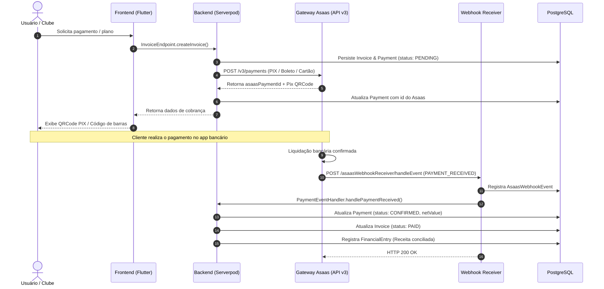

# Fluxo Financeiro & Integração Asaas

> Documentação do ciclo financeiro, onboarding de subcontas, geração de faturas e conciliação assíncrona via Webhooks do Asaas.

---

## 1. Visão Geral

O módulo financeiro do **One-Shot** opera de forma multitenant e modular, atendendo três contextos principais:
1. **Backoffice:** Gestão de planos de assinatura cobrados dos Clubes, Armarias e Atiradores.
2. **Clubes de Tiro:** Cobrança de mensalidades de sócios, locação de pistas e inscrições em campeonatos.
3. **Armarias:** Emissão de cobranças vinculadas a Ordens de Serviço (OS) e manutenção de armamentos.

Para processar pagamentos sem intermediar custódia financeira direta, a plataforma utiliza a infraestrutura de **Subcontas do Asaas**, com processamento de PIX, Cartão de Crédito e Boleto Bancário.

---

## 2. Atores e Componentes

| Componente | Localização | Responsabilidade |
|---|---|---|
| **App / Front-end** | `apps/backoffice_web`, `apps/company_portal` | Solicitação de faturas, seleção de planos e visualização de extrato |
| **Payment Endpoint** | [`payment_endpoint.dart`](file:///Users/ggbailheri/Developer/oneshot/oneshot/oneshot_server/lib/src/endpoints/payment_endpoint.dart) | Endpoint Serverpod para criação e consulta de pagamentos locais |
| **Asaas Gateway Services** | [`oneshot_server/lib/src/gateway/asaas/services`](file:///Users/ggbailheri/Developer/oneshot/oneshot/oneshot_server/lib/src/gateway/asaas/services) | Serviços que encapsulam chamadas HTTP à API v3 do Asaas |
| **Webhook Receiver** | [`asaas_webhook_receiver_endpoint.dart`](file:///Users/ggbailheri/Developer/oneshot/oneshot/oneshot_server/lib/src/gateway/asaas/endpoints/asaas_webhook_receiver_endpoint.dart) | Endpoint público (server-to-server) que recebe notificações de eventos |
| **Event Handlers** | [`oneshot_server/lib/src/gateway/asaas/services/handlers`](file:///Users/ggbailheri/Developer/oneshot/oneshot/oneshot_server/lib/src/gateway/asaas/services/handlers) | `PaymentEventHandler`, `TransferEventHandler` e `AccountEventHandler` |

---

## 3. Subfluxos de Negócio

### A. Onboarding de Subcontas (Clube ou Armaria)

Ao registrar um novo estabelecimento (ex.: [`GunsmithEndpoint.createGunsmith`](file:///Users/ggbailheri/Developer/oneshot/oneshot/oneshot_server/lib/src/endpoints/gunsmith_endpoint.dart)):
1. O sistema inicia uma transação no banco de dados (`session.db.transaction`).
2. Persiste a entidade local com status inicial.
3. Invoca `AsaasOnboardingService.createSubAccount()`.
4. Caso a criação na API do Asaas falhe (por dados inválidos de CNPJ/endereço), uma exceção tipada é lançada e a transação local sofre rollback automático.
5. Se for bem-sucedido, o `asaasAccountId` e a `apiKey` dedicada da subconta são vinculados e persistidos.

### B. Emissão de Fatura e Cobrança

1. O cliente solicita uma nova cobrança ou adesão a plano (`SubscriptionPlan`).
2. O backend gera o registro de `Invoice` e `Payment` com status `PENDING`.
3. O serviço `AsaasPaymentService` envia os dados para a API do Asaas (`/v3/payments`), obtendo:
   - Identificador Asaas (`asaasPaymentId`).
   - Linha digitável e URL do boleto ou QRCode PIX dinâmico.
4. O cliente recebe as informações de pagamento via RPC tipado.

### C. Notificação e Conciliação via Webhook

1. O pagador liquida a cobrança no banco emissor.
2. O Asaas dispara uma requisição `POST` para `AsaasWebhookReceiverEndpoint.handleEvent`.
3. O payload é armazenado como `AsaasWebhookEvent` para auditoria e controle de idempotência.
4. O `PaymentEventHandler` decodifica o evento:
   - `PAYMENT_RECEIVED` ou `PAYMENT_CONFIRMED`:
     - Atualiza `Payment.status` para `PaymentStatus.confirmed`.
     - Grava o valor líquido creditado (`asaasNetValue`).
     - Localiza a `Invoice` vinculada e altera seu status para `InvoiceStatus.paid`.
     - Atualiza o lançamento em `FinancialEntry` para conciliação contábil.
   - `PAYMENT_OVERDUE`: marca pagamento e fatura como vencidos.
   - `PAYMENT_REFUNDED`: atualiza fatura para estornada e lança contrapartida de débito.

---

## 4. Diagrama de Sequência (Ciclo Completo de Cobrança)

---

## 5. Referências de Código e Decisões

- **ADRs Relacionadas:**
  - [`ADR-0001`](file:///Users/ggbailheri/Developer/oneshot/oneshot/docs/adr/0001-arquitetura-backend-clean-architecture-serverpod.md): Isolamento das regras em Use Cases e Repositórios.
  - [`ADR-0004`](file:///Users/ggbailheri/Developer/oneshot/oneshot/docs/adr/0004-monorepo-full-stack-dart-rpc-serverpod-client.md): Contratos de DTOs e entidades gerados no cliente.
- **Modelos Principais:** `Invoice`, `Payment`, `BankAccount`, `FinancialEntry`, `AsaasWebhookEvent`.

