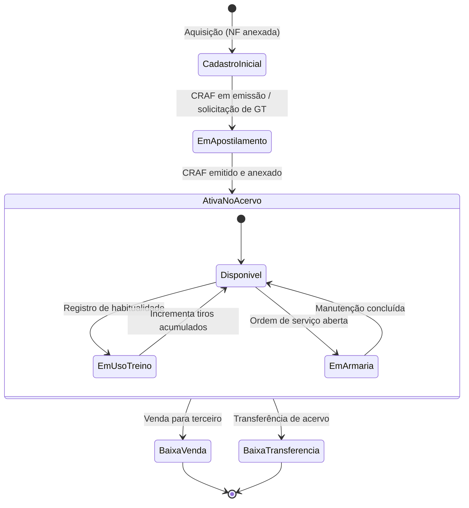
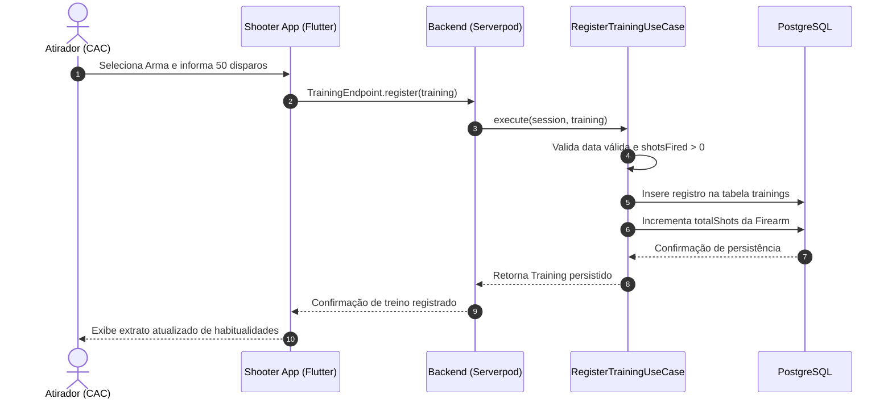

# Fluxo de Gestão de Acervo e Armamento (CAC)

> Documentação do ciclo de vida do armamento, conformidade documental regulatória (SIGMA/SINARM) e registro de habitualidades/treinamentos.

---

## 1. Visão Geral

Para atiradores desportivos, caçadores e colecionadores (CACs), a posse e o transporte de armas de fogo e insumos exigem estrita conformidade documental com os órgãos reguladores (Exército Brasileiro / SIGMA e Polícia Federal / SINARM).

O módulo de acervo do **One-Shot** permite ao atirador:
- Manter o inventário técnico detalhado de cada arma (modelo, número de série, calibre, acabamento, raiamento, medidas e fotos).
- Anexar documentos digitais comprobatórios (Certificado de Registro - CR, Certificado de Registro de Arma de Fogo - CRAF, Guia de Tráfego - GT e Notas Fiscais).
- Registrar treinos e competições para comprovação de habitualidade (exigência legal para renovação de registros).
- Rastrear a contagem acumulada de disparos (`shotsFired`) e o histórico de manutenções preventivas.

---

## 2. Modelos Envolvidos

| Modelo | Entidade Serverpod | Finalidade |
|---|---|---|
| **`Firearm`** | `firearms` | Cadastro das especificações técnicas, calibres, número de série e dono |
| **`Document`** | `documents` | Armazenamento de metadados e arquivos (CRAF, CR, GT, NF) com datas de validade |
| **`Accessory`** | `accessories` | Miras ópticas, miras holográficas, carregadores, dies e prensas de recarga |
| **`Training`** | `trainings` | Registro de data, local, arma utilizada e disparos efetuados |
| **`RangeVisit`** | `range_visits` | Comprovação física de presença no estande do clube conveniado |

---

## 3. Ciclo de Vida da Arma no Sistema

---

## 4. Subfluxos de Negócio

### A. Cadastro de Nova Arma e Documentação

1. O atirador insere os dados da arma no `apps/shooter_app`:
   - Fabricante, modelo, número de série, país de fabricação.
   - Calibre, comprimento do cano, número e sentido das raias.
   - Finalidade (Esporte, Defesa, Caça ou Coleção).
2. O aplicativo anexa a foto da arma e a via digital do **CRAF** e **Nota Fiscal** através do `DocumentEndpoint`.
3. O endpoint [`FirearmEndpoint.create`](file:///Users/ggbailheri/Developer/oneshot/oneshot/oneshot_server/lib/src/endpoints/firearm_endpoint.dart) persiste a arma associando o UUID do proprietário (`ownerId`).

### B. Registro de Treinamento e Comprovação de Habitualidade

1. No clube de tiro, o atirador realiza sua sessão de disparos.
2. No app, seleciona a arma utilizada, o clube conveniado e o número de disparos efetuados.
3. O endpoint [`TrainingEndpoint.register`](file:///Users/ggbailheri/Developer/oneshot/oneshot/oneshot_server/lib/src/endpoints/training_endpoint.dart) aciona o caso de uso [`RegisterTrainingUseCase`](file:///Users/ggbailheri/Developer/oneshot/oneshot/oneshot_server/lib/src/domain/use_cases/register_training_use_case.dart):
   - Valida consistência de data (bloqueia datas futuras inconsistentes).
   - Valida que a quantidade de tiros é positiva (`shotsFired > 0`).
   - Persiste o registro de treino.
   - Atualiza o totalizador de disparos da arma correspondente.
4. Caso o estande de tiro utilize o One-Shot, o clube confirma a presença via [`RegisterRangeVisitUseCase`](file:///Users/ggbailheri/Developer/oneshot/oneshot/oneshot_server/lib/src/domain/use_cases/register_range_visit_use_case.dart), gerando uma habitualidade com fé pública digital para auditorias do Exército/PF.

---

## 5. Diagrama de Sequência (Registro de Habitualidade)

---

## 6. Referências de Código e Decisões

- **ADRs Relacionadas:**
  - [`ADR-0001`](file:///Users/ggbailheri/Developer/oneshot/oneshot/docs/adr/0001-arquitetura-backend-clean-architecture-serverpod.md): Arquitetura backend desacoplada em Use Cases.
  - [`ADR-0006`](file:///Users/ggbailheri/Developer/oneshot/oneshot/docs/adr/0006-componentizacao-estrita-ui-classes-widget.md): Componentes isolados para formulários complexos de armas e documentos.
- **Arquivos-Chave:**
  - `FirearmEndpoint`: [`firearm_endpoint.dart`](file:///Users/ggbailheri/Developer/oneshot/oneshot/oneshot_server/lib/src/endpoints/firearm_endpoint.dart)
  - `TrainingUseCase`: [`register_training_use_case.dart`](file:///Users/ggbailheri/Developer/oneshot/oneshot/oneshot_server/lib/src/domain/use_cases/register_training_use_case.dart)

