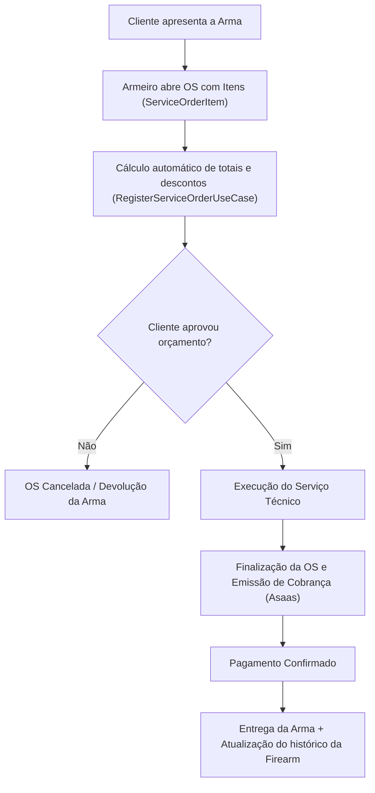
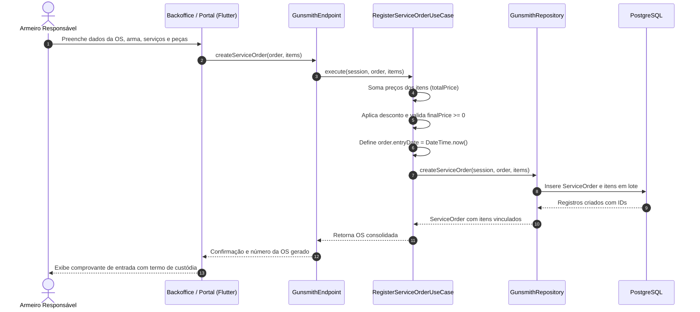

# Fluxo de Armaria e Ordens de Serviço (OS)

> Documentação do ciclo de prestação de serviços de armaria, abertura de Ordens de Serviço (OS), cálculo de orçamentos e emissão de cobranças.

---

## 1. Visão Geral

O módulo de armaria atende profissionais e estabelecimentos especializados na manutenção, reparo, customização, restauração e aplicação de acabamentos (ex.: Cerakote, nitretação, polimento) em armas de fogo.

O fluxo garante:
- Rastreabilidade legal da custódia do armamento enquanto estiver no estabelecimento do armeiro.
- Abertura de Ordem de Serviço com discriminação de mão de obra e peças substituídas.
- Cálculo automático de valores, descontos e validação de regras financeiras.
- Emissão de cobrança direta integrada à subconta do armeiro no Asaas.
- Registro da manutenção concluída diretamente no prontuário histórico da arma (`Firearm`).

---

## 2. Componentes e Modelos

| Modelo / Classe | Tipo | Responsabilidade |
|---|---|---|
| **`Gunsmith`** | Entidade | Dados cadastrais do estabelecimento, proprietário e subconta Asaas |
| **`ServiceOrder`** | Entidade | Cabeçalho da Ordem de Serviço: cliente, arma, status, datas e valores |
| **`ServiceOrderItem`** | Entidade | Descrição do serviço/peça, quantidade e valor unitário |
| **`GunsmithEndpoint`** | Endpoint | Exposição RPC dos métodos de armaria para o portal web |
| **`RegisterServiceOrderUseCase`** | Use Case | Regra de negócio de cálculo de totais, desconto, validação e persistência |

---

## 3. Ciclo de Atendimento da Ordem de Serviço

---

## 4. Detalhamento Técnico do Fluxo

### A. Criação do Estabelecimento de Armaria

Conforme implementado em [`GunsmithEndpoint.createGunsmith`](file:///Users/ggbailheri/Developer/oneshot/oneshot/oneshot_server/lib/src/endpoints/gunsmith_endpoint.dart):
1. O usuário autenticado tem seu perfil validado (`getOrCreateProfileUseCase`).
2. O armeiro é persistido no banco local sob uma transação (`session.db.transaction`).
3. O sistema cria de forma síncrona uma subconta no Asaas via `AsaasOnboardingService`.
4. Em caso de sucesso, a subconta fica habilitada para receber pagamentos de clientes finais.

### B. Abertura e Validação da Ordem de Serviço

Quando o armeiro registra uma nova OS com itens:
1. O método [`RegisterServiceOrderUseCase.execute`](file:///Users/ggbailheri/Developer/oneshot/oneshot/oneshot_server/lib/src/domain/use_cases/register_service_order_use_case.dart) é acionado.
2. É iterada a lista de `ServiceOrderItem`, totalizando `totalPrice`.
3. Aplica o desconto (`discount`), calculando `finalPrice = totalPrice - discount`.
4. Valida a invariante de negócio: se `finalPrice < 0`, aborta lançando exceção (`Exception`).
5. Atribui a data de entrada (`order.entryDate = DateTime.now()`).
6. Grava atomicamente a ordem e todos os itens vinculados via `IGunsmithRepository.createServiceOrder`.

### C. Conclusão e Entrega

1. Com o serviço técnico concluído, o status da OS avança para `COMPLETED`.
2. O sistema gera a fatura correspondente via integração Asaas.
3. Ao liquidar o pagamento, o histórico de limpezas e manutenções da arma é atualizado com o número da OS e serviços realizados, valorizando o prontuário do acervo do atirador.

---

## 5. Diagrama de Sequência (Registro de OS)

---

## 6. Referências de Código e Decisões

- **ADRs Relacionadas:**
  - [`ADR-0001`](file:///Users/ggbailheri/Developer/oneshot/oneshot/docs/adr/0001-arquitetura-backend-clean-architecture-serverpod.md): Arquitetura baseada em casos de uso de aplicação.
  - [`ADR-0004`](file:///Users/ggbailheri/Developer/oneshot/oneshot/docs/adr/0004-monorepo-full-stack-dart-rpc-serverpod-client.md): Modelos de Ordens de Serviço compartilhados tipados no client.
- **Arquivos-Chave:**
  - `GunsmithEndpoint`: [`gunsmith_endpoint.dart`](file:///Users/ggbailheri/Developer/oneshot/oneshot/oneshot_server/lib/src/endpoints/gunsmith_endpoint.dart)
  - `RegisterServiceOrderUseCase`: [`register_service_order_use_case.dart`](file:///Users/ggbailheri/Developer/oneshot/oneshot/oneshot_server/lib/src/domain/use_cases/register_service_order_use_case.dart)

