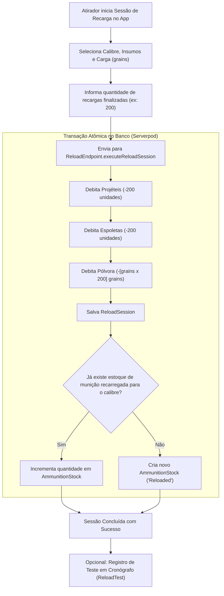
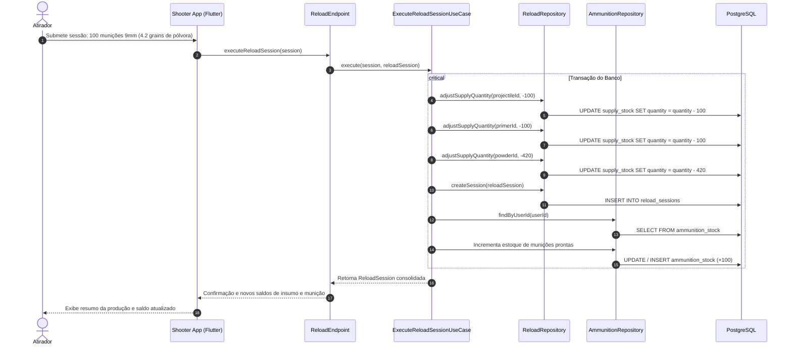

# Fluxo de Recarga de Munições e Testes Balísticos

> Documentação do controle de insumos de recarga, débito de estoque em lote, criação de munições prontas e aferição de testes em cronógrafo.

---

## 1. Visão Geral

A recarga de munições é uma atividade regulamentada fundamental para atiradores desportivos de alto rendimento. Envolve o controle estrito de insumos controlados:
- **Pólvora:** medida e consumida em *grains* por projétil.
- **Espoletas (Primers):** consumidas por unidade.
- **Projéteis (Projectiles):** consumidos por unidade.
- **Estojos (Brass/Cases):** reaproveitados e inspecionados por lote.

O módulo de recarga do **One-Shot** automatiza o balanço de massa dos insumos, assegura a consistência transacional do estoque e permite ao atirador registrar cronografagens de velocidade para cálculo do fator de potência exigido em divisões esportivas (ex.: IPSC, IDPA).

---

## 2. Componentes e Entidades

| Entidade / Caso de Uso | Responsabilidade |
|---|---|
| **`SupplyStock`** | Estoque de insumos individuais (pólvora, espoleta, projétil, estojo) |
| **`ReloadSession`** | Cabeçalho da sessão: calibre, tipo de pólvora, carga em grains, projétil, espoleta e quantidade produzida (`reloadsCompleted`) |
| **`AmmunitionStock`** | Estoque de munições prontas (tipo `Factory` ou `Reloaded`) |
| **`ReloadTest`** | Registro de testes de disparo com aferição de velocidade por tiro em cronógrafo |
| **`ExecuteReloadSessionUseCase`** | Orquestrador transacional de débito de insumos e crédito de munições |

---

## 3. Fluxo de Execução da Recarga

---

## 4. Detalhamento das Regras de Negócio

### A. Débito Transacional de Insumos

Implementado em [`ExecuteReloadSessionUseCase.execute`](file:///Users/ggbailheri/Developer/oneshot/oneshot/oneshot_server/lib/src/domain/use_cases/execute_reload_session_use_case.dart):
1. O total de recargas concluídas (`reloadsCompleted`) é multiplicado pela carga unitária:
   - Projéteis: `- totalReloads`
   - Espoletas: `- totalReloads`
   - Pólvora: `- (powderGrains * totalReloads)`
2. O repositório [`ReloadRepository.adjustSupplyQuantity`](file:///Users/ggbailheri/Developer/oneshot/oneshot/oneshot_server/lib/src/data/repositories_impl/reload_repository.dart) ajusta as quantidades de forma atômica no banco de dados.
3. Se qualquer insumo atingir saldo inconsistente ou falhar na transação, a operação é revertida sem perda de dados.

### B. Crédito em Munições Prontas

1. Após salvar a `ReloadSession`, o sistema busca em `AmmunitionRepository` se o atirador já possui um lote de estoque com `caliber == session.caliber` e `type == 'Reloaded'`.
2. Se existir, o saldo é incrementado em `totalReloads`.
3. Se não existir, um novo lote é instanciado (`manufacturer: 'Self Reload'`, `type: 'Reloaded'`) e persistido.

### C. Testes em Cronógrafo (`ReloadTest`)

1. O atirador leva um lote de teste ao estande com cronógrafo balístico.
2. Registra as leituras de velocidade de cada tiro (em pés/segundo ou metros/segundo).
3. O endpoint `ReloadEndpoint.registerTest` valida a propriedade da sessão e vincula o teste ao lote de recarga, permitindo avaliar a regularidade (desvio padrão) e segurança da queima da pólvora.

---

## 5. Diagrama de Sequência (Execução de Recarga)

---

## 6. Referências de Código e Decisões

- **ADRs Relacionadas:**
  - [`ADR-0001`](file:///Users/ggbailheri/Developer/oneshot/oneshot/docs/adr/0001-arquitetura-backend-clean-architecture-serverpod.md): Lógica transacional isolada em casos de uso.
  - [`ADR-0005`](file:///Users/ggbailheri/Developer/oneshot/oneshot/docs/adr/0005-testes-integracao-banco-efemero-serverpod-test.md): Testes de recarga executados com isolamento de banco.
- **Arquivos-Chave:**
  - `ExecuteReloadSessionUseCase`: [`execute_reload_session_use_case.dart`](file:///Users/ggbailheri/Developer/oneshot/oneshot/oneshot_server/lib/src/domain/use_cases/execute_reload_session_use_case.dart)
  - `ReloadEndpoint`: [`reload_endpoint.dart`](file:///Users/ggbailheri/Developer/oneshot/oneshot/oneshot_server/lib/src/endpoints/reload_endpoint.dart)

