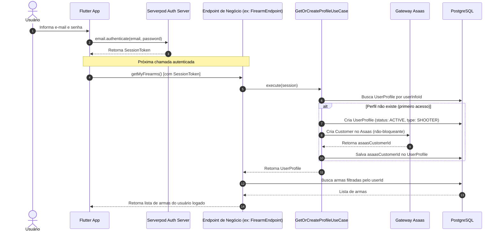

# Fluxo de Autenticação, Perfis e Controle de Acesso (RBAC)

> Documentação da gestão de identidade, sessão de usuário, provisionamento sob demanda de perfil e controle de acesso granular multi-tenant (RBAC).

---

## 1. Visão Geral

O ecossistema **One-Shot** atende simultaneamente múltiplos públicos com níveis de privilégio distintos:
1. **Administradores da Plataforma (Backoffice):** Acesso a métricas globais, gestão de empresas cadastradas, faturamento e concessão de papéis.
2. **Gestores de Clubes e Armarias:** Controle das informações de seu próprio clube/empresa, gestão de membros (`Membership`), planos de sócios e faturamento local.
3. **Atiradores Desportivos (CACs):** Visualização e manutenção restrita ao seu próprio acervo, documentos, treinos e finanças pessoais.

Para garantir segurança e isolamento, o sistema combina:
- **Serverpod Auth:** Autenticação de credenciais via e-mail e senha, com emissão de tokens de sessão criptografados.
- **Perfil Sob Demanda (`UserProfile`):** Vinculação preguiçosa entre a identidade de autenticação (`UserInfo`) e o perfil de domínio.
- **RBAC (Role-Based Access Control):** Concessão de papéis (`SecurityRole`) e permissões granulares (`RolePermission`).
- **Segregação de Origem (`originModule`):** Filtros nativos nos endpoints garantindo que dados de um clube não sejam visualizados por outro.

---

## 2. Entidades Principais

| Entidade | Camada | Descrição |
|---|---|---|
| **`UserInfo`** | `serverpod_auth` | Dados de autenticação (e-mail, hash de senha, ID inteiro) |
| **`UserProfile`** | Domínio One-Shot | Perfil completo (UUID, CPF, tipos de usuário, status, ID Asaas) |
| **`SecurityRole`** | Acesso | Papel atribuído (ex: "Admin", "Armeiro", "Secretaria do Clube") |
| **`RolePermission`** | Acesso | Ação e módulo permitidos para um determinado papel |
| **`Membership`** | Associação | Vínculo contratual entre um atirador (`UserProfile`) e um clube (`Company`) |

---

## 3. Subfluxos de Identidade e Acesso

### A. Login e Inicialização de Sessão

1. O usuário submete credenciais (e-mail e senha) em um dos aplicativos Flutter (`shooter_app`, `backoffice_web` ou `company_portal`).
2. O pacote `serverpod_auth_email_flutter` valida os dados contra o módulo de autenticação do servidor.
3. O servidor emite uma chave de autenticação (`keyId` e `keySecret`).
4. O cliente armazena a chave de forma segura no dispositivo via `FlutterAuthenticationKeyManager` e a anexa automaticamente em todas as requisições RPC subsequentes.

### B. Provisionamento Preguiçoso do Perfil (`GetOrCreateProfileUseCase`)

Ao realizar qualquer operação autenticada pela primeira vez (ex.: cadastrar uma arma, acessar o perfil ou registrar um treino):
1. O backend intercepta a sessão e aciona o caso de uso [`GetOrCreateProfileUseCase`](file:///Users/ggbailheri/Developer/oneshot/oneshot/oneshot_server/lib/src/domain/use_cases/get_or_create_profile_use_case.dart).
2. O sistema verifica se já existe um `UserProfile` para o `auth.userId` autenticado.
3. Se não existir:
   - Cria um novo registro `UserProfile` com `types: [UserType.shooter]` e `status: UserStatus.active`.
   - Dispara em segundo plano a criação do cliente correspondente no Asaas (`_createAsaasCustomer`).
   - Caso a criação no Asaas falhe (por exemplo, por falta momentânea de CPF completo), o perfil local é mantido e a razão da pendência é registrada em `asaasOnboardingFailureReason` sem interromper a navegação do usuário.

### C. Autorização e Isolamento Multitenant

1. Cada endpoint valida a identidade chamando `session.authenticated`.
2. Para operações restritas a estabelecimentos (clubes/armarias), os repositórios filtram os registros pelo `companyId` ou `originModule` da sessão ativa.
3. Usuários comuns não possuem privilégios de alterar planos globais ou visualizar movimentações financeiras de terceiros.

---

## 4. Diagrama de Sequência (Autenticação e Resolução de Perfil)

---

## 5. Referências de Código e Decisões

- **ADRs Relacionadas:**
  - [`ADR-0001`](file:///Users/ggbailheri/Developer/oneshot/oneshot/docs/adr/0001-arquitetura-backend-clean-architecture-serverpod.md): Resolução de perfil encapsulada em Use Case.
  - [`ADR-0004`](file:///Users/ggbailheri/Developer/oneshot/oneshot/docs/adr/0004-monorepo-full-stack-dart-rpc-serverpod-client.md): Compartilhamento tipado dos modelos de autenticação e sessão.
- **Arquivos-Chave:**
  - `GetOrCreateProfileUseCase`: [`get_or_create_profile_use_case.dart`](file:///Users/ggbailheri/Developer/oneshot/oneshot/oneshot_server/lib/src/domain/use_cases/get_or_create_profile_use_case.dart)
  - `SecurityRoleEndpoint`: [`security_role_endpoint.dart`](file:///Users/ggbailheri/Developer/oneshot/oneshot/oneshot_server/lib/src/endpoints/security_role_endpoint.dart)

