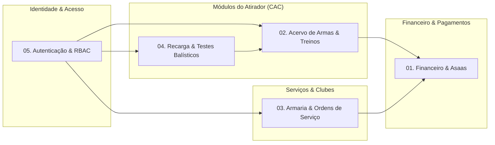

# Índice de Fluxos de Arquitetura e Negócio — One-Shot

> Catálogo e mapa de navegação dos fluxos operacionais e técnicos do ecossistema One-Shot.

---

## 1. Visão Geral

Enquanto as [Architecture Decision Records (ADRs)](file:///Users/ggbailheri/Developer/oneshot/oneshot/docs/adr/INDEX.md) documentam as decisões estruturais estáticas do projeto (por que escolhemos cada tecnologia e padrão), os **Fluxos de Negócio** documentam a dinâmica operacional em tempo de execução: o ciclo de vida dos dados, interações entre componentes e integrações externas.

---

## 2. Catálogo de Fluxos

| Fluxo | Título | Escopo e Responsabilidade | Atores / Integrações |
|---|---|---|---|
| [`01`](file:///Users/ggbailheri/Developer/oneshot/oneshot/docs/flows/01-fluxo-financeiro-asaas.md) | **[Financeiro & Integração Asaas](file:///Users/ggbailheri/Developer/oneshot/oneshot/docs/flows/01-fluxo-financeiro-asaas.md)** | Onboarding de subcontas, geração de faturas (PIX/Boleto/Cartão) e conciliação assíncrona via Webhooks | Backoffice, Clubes, Armarias, Gateway Asaas |
| [`02`](file:///Users/ggbailheri/Developer/oneshot/oneshot/docs/flows/02-fluxo-acervo-cac-armas.md) | **[Gestão de Acervo e Armamento (CAC)](file:///Users/ggbailheri/Developer/oneshot/oneshot/docs/flows/02-fluxo-acervo-cac-armas.md)** | Cadastro de armas, controle de documentos (CR, CRAF, GT), registros de treinos e comprovação de habitualidade | Atiradores (CAC), Clubes de Tiro, Exército/PF |
| [`03`](file:///Users/ggbailheri/Developer/oneshot/oneshot/docs/flows/03-fluxo-armaria-ordem-servico.md) | **[Armaria e Ordens de Serviço (OS)](file:///Users/ggbailheri/Developer/oneshot/oneshot/docs/flows/03-fluxo-armaria-ordem-servico.md)** | Orçamentação, execução de reparos/customizações em armas, cobrança integrada e histórico no prontuário | Armeiros, Clientes CAC, Gateway Asaas |
| [`04`](file:///Users/ggbailheri/Developer/oneshot/oneshot/docs/flows/04-fluxo-recarga-municoes.md) | **[Recarga de Munições e Testes Balísticos](file:///Users/ggbailheri/Developer/oneshot/oneshot/docs/flows/04-fluxo-recarga-municoes.md)** | Controle de insumos (pólvora, espoletas, projéteis), débito transacional, entrada de munições e cronógrafo | Atiradores de Competição, Insumos Controlados |
| [`05`](file:///Users/ggbailheri/Developer/oneshot/oneshot/docs/flows/05-fluxo-autenticacao-rbac-multitenant.md) | **[Autenticação, Perfis e RBAC](file:///Users/ggbailheri/Developer/oneshot/oneshot/docs/flows/05-fluxo-autenticacao-rbac-multitenant.md)** | Gestão de sessão, provisionamento sob demanda de perfil (`UserProfile`), papéis e isolamento multitenant | Todos os usuários, Serverpod Auth |

---

## 3. Próximos Passos e Manutenção

- Ao implementar novos endpoints ou alterar o comportamento transacional de uma entidade, mantenha este catálogo atualizado.
- Decisões estruturais que alterem a forma como os fluxos são desenhados devem ser registradas previamente como novas ADRs em [`docs/adr/`](file:///Users/ggbailheri/Developer/oneshot/oneshot/docs/adr/INDEX.md).

